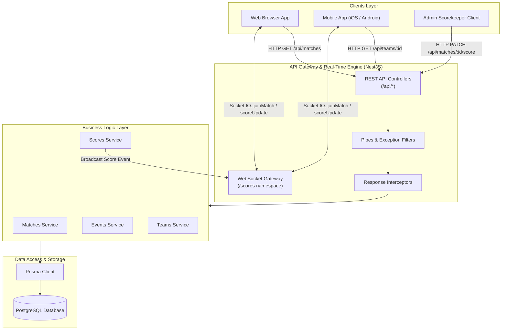
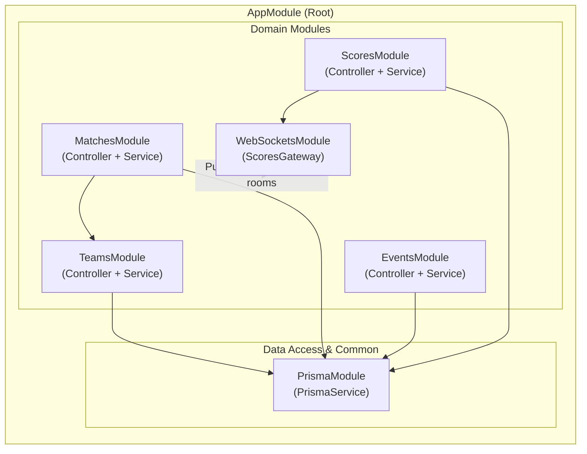
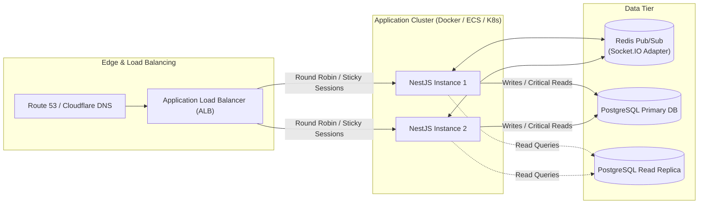

# High-Level Design (HLD): Live Sports Score Platform

## 1. Executive Summary & Overview

The **Live Sports Score Platform** is designed to provide real-time score tracking, event logging, and match overview capabilities for high-traffic sports monitoring applications. The platform delivers dual communication interfaces:
1. **RESTful HTTP API**: Provides CRUD operations, structured queries, and historic lookups (matches, teams, timeline events, scores).
2. **WebSocket Gateway**: Offers full-duplex, low-latency live score broadcasts to millions of concurrent connected spectators organized into room channels by match.

The system is designed with modularity, predictable consistency, loose coupling, and horizontal scalability as core architectural tenets.

---

## 2. Architecture Overview

The system follows a layered, micro-service-ready modular architecture built on NestJS and backed by PostgreSQL and Socket.IO rooms.

---

## 3. Component Diagram

The application is decomposed into cohesive modules inside NestJS's dependency injection container, ensuring clean separation of concerns and maintainability.

### Module Responsibilities:
- **`PrismaModule`**: Encapsulates database connection pooling, lifecycle management, and Prisma query engine execution.
- **`TeamsModule`**: Handles team entity retrieval, profiles, and team metadata.
- **`MatchesModule`**: Manages fixtures, scheduled matches, ongoing matches, status filters, and search queries across teams.
- **`ScoresModule`**: Manages match score state, calculates updates, supports upsert operations, and triggers real-time broadcast events.
- **`EventsModule`**: Chronologically tracks timeline events during a match (e.g., goals, fouls, cards, wickets, points).
- **`WebSocketsModule`**: Hosts Socket.IO gateways, manages socket lifecycles, assigns connections to rooms (`match_{id}`), and pushes updates.

---

## 4. Tech Stack Justification

| Technology | Selection Rationale | Alternatives Considered | Trade-off Analysis |
|---|---|---|---|
| **NestJS** | Enterprise-grade TypeScript framework, opinionated modular structure, dependency injection, built-in validation, and out-of-the-box WebSocket integration. | Express.js, Fastify, Go Gin | Adds slight boilerplate compared to pure Express, but provides strict architecture, standardization, and maintainability. |
| **PostgreSQL** | ACID-compliant relational DB with strong guarantees for score and event transactions, excellent indexing for foreign keys, and relational integrity. | MongoDB, MySQL, Cassandra | Relational models prevent orphan records (e.g., scores without matches). NoSQL is faster for unconstrained writes but lacks strict relational constraints. |
| **Prisma ORM** | Type-safe query generation, auto-generated TypeScript models, declarative schema migrations, and intuitive query API. | TypeORM, Sequelize, Kysely | Slightly higher engine overhead than raw SQL, but eliminates mismatch runtime bugs and schema drift. |
| **Socket.IO** | Automatic fallback (long polling), built-in room management (`join`/`leave`), connection reconnection, and heartbeat monitoring. | Raw WebSockets (ws), SSE, gRPC Streams | Heavier client/server payload than raw WS, but built-in room abstraction drastically simplifies match-specific broadcasting. |
| **Docker Compose** | Reproducible local development and consistent container environments across all developers and CI/CD pipelines. | Local Postgres installs, Cloud DBs | Requires Docker engine installed, but eliminates host environment divergence. |

---

## 5. End-to-End Data Flow

### 5.1 Real-Time Score Update Lifecycle
1. **Operator Action**: An authorized admin/referee client sends an authenticated `PATCH /api/matches/:id/score` request with updated score metrics.
2. **Validation & Filtering**: The request passes through NestJS global pipes (`ValidationPipe`), ensuring whitelist conformance, payload types, and constraints (e.g., non-negative scores).
3. **Database Upsert**: `ScoresService` interacts with `PrismaService` inside a transaction or upsert operation:
   - Validates that the target match exists.
   - Updates the existing score record or initializes a new one.
4. **WebSocket Broadcast**: Upon successful commit, `ScoresService` notifies `ScoresGateway`. The gateway emits `scoreUpdate` targeting the specific room channel `match_<id>`.
5. **Client Notification**: Connected web and mobile clients in room `match_<id>` receive the push notification and re-render their UI without polling the server.
6. **HTTP Response**: The controller returns a standardized payload `{ success: true, data: updatedScore, timestamp: ... }` with HTTP status `200`.

### 5.2 Match Discovery and Search Flow
1. **Client Search**: Client requests `GET /api/matches?search=India`.
2. **Query Processing**: `MatchesService` queries Prisma using case-insensitive `contains` filters across `homeTeam.name` and `awayTeam.name`.
3. **Response Interception**: `ResponseInterceptor` formats the response payload uniformly before returning to the caller.

---

## 6. Non-Functional Requirements (NFRs)

### 6.1 Scalability
- **Horizontal Gateway Scaling**: When running multiple NestJS app instances behind a reverse proxy (e.g., NGINX / AWS ALB), Socket.IO supports the `@socket.io/redis-adapter` to distribute room broadcasts across nodes.
- **Connection Multiplexing**: Sockets utilize heartbeat intervals (25s ping, 20s timeout) to quickly reclaim abandoned connections and reduce memory footprints.
- **Database Connection Pooling**: Prisma manages a connection pool tuned via database connection string parameters (e.g., `connection_limit=20`).

### 6.2 Reliability & Fault Tolerance
- **Transactional Consistency**: Score updates and event insertions are verified against foreign keys to guarantee reference validity.
- **Graceful Degradation**: If WebSocket transport fails on the client side, Socket.IO seamlessly falls back to HTTP long-polling.
- **Global Error Handling**: `HttpExceptionFilter` intercepts exceptions, sanitizes sensitive stack traces in production, and guarantees standardized error formats.

### 6.3 Performance & Latency
- REST API p95 response time target: `< 50ms`.
- WebSocket broadcast latency from server commit to client receipt: `< 100ms`.
- Indexed lookup fields on foreign keys (`matchId`, `homeTeamId`, `awayTeamId`).

---

## 7. Deployment Architecture

- **Containerized Workloads**: Standard Docker images running Node.js Alpine base.
- **Sticky Sessions / WebSocket Affinity**: Configured on the load balancer to support initial WebSocket handshake negotiation when polling is active.
- **Environment Parity**: Database migrations executed automatically as part of CI/CD pre-deployment pipelines (`prisma migrate deploy`).
