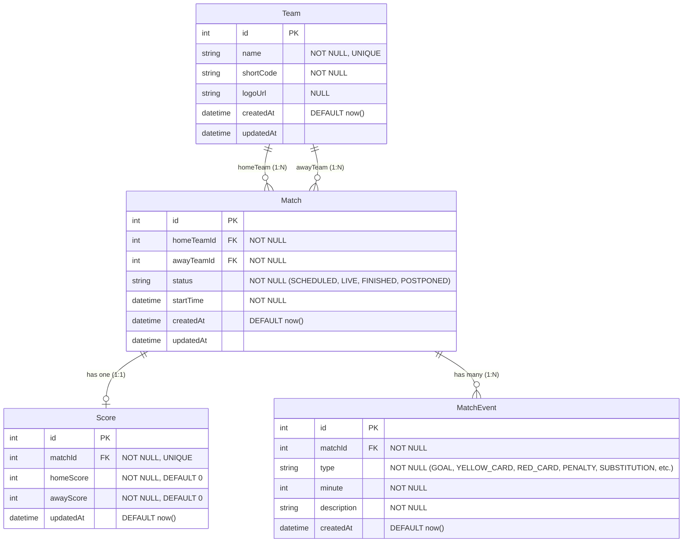
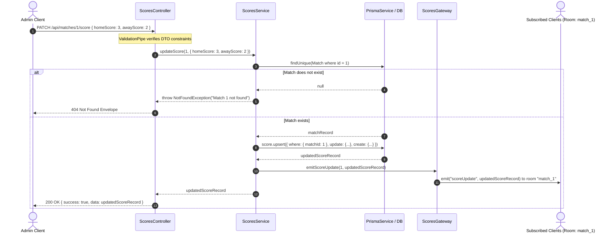

# Low-Level Design (LLD): Live Sports Score Platform

## 1. Title & Overview

The **Low-Level Design (LLD)** defines the concrete database schemas, constraints, API payloads, class interactions, error filtering, and WebSocket messaging schemas for the Live Sports Score API.

---

## 2. Database ER Diagram

The database consists of 4 primary relational tables: `Team`, `Match`, `Score`, and `MatchEvent`.



---

## 3. Database Table Definitions

### 3.1 `Team` Table
Stores participant teams and club metadata.

| Column | Type | Nullable | Constraints & Defaults | Description |
|---|---|---|---|---|
| `id` | `SERIAL` (Int) | No | `PRIMARY KEY` | Unique team identifier |
| `name` | `VARCHAR(100)` | No | `UNIQUE` | Full team name (e.g., "India", "Arsenal") |
| `shortCode` | `VARCHAR(10)` | No | - | Ticker code (e.g., "IND", "ARS") |
| `logoUrl` | `TEXT` | Yes | - | Asset URL for team badge / logo |
| `createdAt` | `TIMESTAMP` | No | `DEFAULT CURRENT_TIMESTAMP` | Record creation timestamp |
| `updatedAt` | `TIMESTAMP` | No | Auto-updated on update | Record modification timestamp |

### 3.2 `Match` Table
Stores fixtures, state, and team assignments.

| Column | Type | Nullable | Constraints & Defaults | Description |
|---|---|---|---|---|
| `id` | `SERIAL` (Int) | No | `PRIMARY KEY` | Unique match identifier |
| `homeTeamId` | `INTEGER` | No | `REFERENCES Team(id) ON DELETE RESTRICT` | Home team foreign key |
| `awayTeamId` | `INTEGER` | No | `REFERENCES Team(id) ON DELETE RESTRICT` | Away team foreign key |
| `status` | `VARCHAR(20)` | No | `DEFAULT 'SCHEDULED'` | Match status (`SCHEDULED`, `LIVE`, `FINISHED`, `CANCELLED`) |
| `startTime` | `TIMESTAMP` | No | - | Scheduled kick-off timestamp |
| `createdAt` | `TIMESTAMP` | No | `DEFAULT CURRENT_TIMESTAMP` | Match creation timestamp |
| `updatedAt` | `TIMESTAMP` | No | Auto-updated on update | Match update timestamp |

### 3.3 `Score` Table
Maintains current real-time match points/goals. Enforces 1:1 relationship with `Match`.

| Column | Type | Nullable | Constraints & Defaults | Description |
|---|---|---|---|---|
| `id` | `SERIAL` (Int) | No | `PRIMARY KEY` | Unique score identifier |
| `matchId` | `INTEGER` | No | `UNIQUE`, `REFERENCES Match(id) ON DELETE CASCADE` | Match relation ID |
| `homeScore` | `INTEGER` | No | `CHECK (homeScore >= 0)`, `DEFAULT 0` | Score points for home team |
| `awayScore` | `INTEGER` | No | `CHECK (awayScore >= 0)`, `DEFAULT 0` | Score points for away team |
| `updatedAt` | `TIMESTAMP` | No | Auto-updated on update | Timestamp of latest score change |

### 3.4 `MatchEvent` Table
Stores timeline incidents and occurrences within a match.

| Column | Type | Nullable | Constraints & Defaults | Description |
|---|---|---|---|---|
| `id` | `SERIAL` (Int) | No | `PRIMARY KEY` | Event ID |
| `matchId` | `INTEGER` | No | `REFERENCES Match(id) ON DELETE CASCADE` | Parent match reference |
| `type` | `VARCHAR(50)` | No | - | Event type (e.g., `GOAL`, `YELLOW_CARD`, `RED_CARD`) |
| `minute` | `INTEGER` | No | `CHECK (minute >= 0)` | Game minute when event occurred |
| `description` | `TEXT` | No | - | Textual description of the event |
| `createdAt` | `TIMESTAMP` | No | `DEFAULT CURRENT_TIMESTAMP` | Event creation timestamp |

---

## 4. API Contracts

All endpoints return a standardized envelope structure produced by `ResponseInterceptor`:

```typescript
export interface StandardResponse<T> {
  success: boolean;
  data: T;
  timestamp: string;
}
```

Error responses produced by `HttpExceptionFilter`:

```typescript
export interface ErrorResponse {
  success: false;
  statusCode: number;
  message: string | string[];
  error?: string;
  timestamp: string;
  path: string;
}
```

---

### 4.1 Matches Endpoints

#### `GET /api/matches`
- **Query Parameters**:
  - `search` (optional string): Filters matches by home or away team name (case-insensitive substring match).
- **Status 200 Response**:
```json
{
  "success": true,
  "data": [
    {
      "id": 1,
      "status": "LIVE",
      "startTime": "2026-10-12T14:00:00.000Z",
      "homeTeam": {
        "id": 1,
        "name": "India",
        "shortCode": "IND",
        "logoUrl": "https://example.com/ind.png"
      },
      "awayTeam": {
        "id": 2,
        "name": "Australia",
        "shortCode": "AUS",
        "logoUrl": "https://example.com/aus.png"
      },
      "score": {
        "id": 1,
        "matchId": 1,
        "homeScore": 2,
        "awayScore": 1,
        "updatedAt": "2026-10-12T14:30:00.000Z"
      }
    }
  ],
  "timestamp": "2026-10-12T15:30:00.000Z"
}
```

#### `GET /api/matches/:id`
- **Path Parameters**: `id` (integer)
- **Status 200 Response**:
```json
{
  "success": true,
  "data": {
    "id": 1,
    "status": "LIVE",
    "startTime": "2026-10-12T14:00:00.000Z",
    "homeTeam": {
      "id": 1,
      "name": "India",
      "shortCode": "IND",
      "logoUrl": "https://example.com/ind.png"
    },
    "awayTeam": {
      "id": 2,
      "name": "Australia",
      "shortCode": "AUS",
      "logoUrl": "https://example.com/aus.png"
    }
  },
  "timestamp": "2026-10-12T15:30:00.000Z"
}
```
- **Status 404 Response**: `{ "success": false, "statusCode": 404, "message": "Match with ID 9999 not found" }`
- **Status 400 Response**: `{ "success": false, "statusCode": 400, "message": "Invalid ID: expected numeric integer" }`

---

### 4.2 Score Endpoints

#### `GET /api/matches/:id/score`
- **Path Parameters**: `id` (integer)
- **Status 200 Response**:
```json
{
  "success": true,
  "data": {
    "id": 1,
    "matchId": 1,
    "homeScore": 2,
    "awayScore": 1,
    "updatedAt": "2026-10-12T14:30:00.000Z"
  },
  "timestamp": "2026-10-12T15:30:00.000Z"
}
```
- **Status 404 Response**: Returned if the match does not exist or has no score record.

#### `PATCH /api/matches/:id/score`
- **Path Parameters**: `id` (integer)
- **Request Body (UpdateScoreDto)**:
```json
{
  "homeScore": 3,
  "awayScore": 2
}
```
  - Validation:
    - `@IsInt()`
    - `@Min(0)`
- **Status 200 Response**:
```json
{
  "success": true,
  "data": {
    "id": 1,
    "matchId": 1,
    "homeScore": 3,
    "awayScore": 2,
    "updatedAt": "2026-10-12T14:35:00.000Z"
  },
  "timestamp": "2026-10-12T15:30:00.000Z"
}
```
- **Status 400 Response**: If validation fails (`homeScore < 0`, missing values, non-integer types).
- **Status 404 Response**: If `matchId` does not exist.

---

### 4.3 Events Endpoints

#### `GET /api/matches/:id/events`
- **Path Parameters**: `id` (integer)
- **Status 200 Response**:
```json
{
  "success": true,
  "data": [
    {
      "id": 1,
      "matchId": 1,
      "type": "GOAL",
      "minute": 15,
      "description": "Goal by Home Forward",
      "createdAt": "2026-10-12T14:15:00.000Z"
    }
  ],
  "timestamp": "2026-10-12T15:30:00.000Z"
}
```

---

### 4.4 Teams Endpoints

#### `GET /api/teams/:id`
- **Path Parameters**: `id` (integer)
- **Status 200 Response**:
```json
{
  "success": true,
  "data": {
    "id": 1,
    "name": "India",
    "shortCode": "IND",
    "logoUrl": "https://example.com/ind.png"
  },
  "timestamp": "2026-10-12T15:30:00.000Z"
}
```

---

## 5. Sequence Diagram: Score Update & Broadcast

The following sequence details what occurs when `PATCH /api/matches/:id/score` is executed:



---

## 6. Error Handling Strategy

1. **Validation Pipeline**:
   - `ValidationPipe` is registered globally with `{ whitelist: true, transform: true, forbidNonWhitelisted: true }`.
   - Any unknown properties or invalid payload structures immediately trigger HTTP 400 Bad Request with descriptive validation violation messages.
2. **Global Exception Filter (`HttpExceptionFilter`)**:
   - Catches all instances of `HttpException` (and unhandled 500 errors).
   - Formats every error into standard shape:
     ```json
     {
       "success": false,
       "statusCode": 404,
       "message": "Match with ID 9999 not found",
       "timestamp": "2026-10-12T15:30:00.000Z",
       "path": "/api/matches/9999"
     }
     ```
3. **Database Error Interception**:
   - Prisma errors such as foreign key violations (`P2003`) or record not found (`P2025`) are translated into clean HTTP exceptions (`NotFoundException` or `BadRequestException`).
4. **ID Parsing Pipe**:
   - Custom `ParseIntPipe` / `ParseIdPipe` validates numeric ID path parameters and throws HTTP 400 if non-numeric characters (`abc`) are supplied.

---

## 7. WebSocket Protocol Specification

- **Namespace**: `/scores`
- **Supported Transports**: `websocket`, `polling`

### 7.1 Client-to-Server Events

#### Event: `joinMatch`
Sent by a client to join the notification room for a specific match.
- **Payload**:
  ```json
  {
    "matchId": 1
  }
  ```
- **Server Action**:
  - Validates `matchId`.
  - Executes `client.join(`match_${matchId}`)`.
  - Emits optional confirmation event or acknowledgement.

#### Event: `leaveMatch`
Sent by a client to leave a specific match's room.
- **Payload**:
  ```json
  {
    "matchId": 1
  }
  ```
- **Server Action**:
  - Executes `client.leave(`match_${matchId}`)`.

---

### 7.2 Server-to-Client Events

#### Event: `scoreUpdate`
Broadcast to all sockets currently in room `match_<id>`.
- **Payload**:
  ```json
  {
    "id": 1,
    "matchId": 1,
    "homeScore": 3,
    "awayScore": 2,
    "updatedAt": "2026-10-12T14:35:30.000Z"
  }
  ```

---

## 8. Data Security and Concurrency Considerations

- **Idempotent Upserts**: `PATCH /api/matches/:id/score` uses atomic database upsert logic keyed on unique index `matchId`. Concurrent requests resolve deterministically with the latest committed timestamp.
- **Non-Negative Constraints**: Score values are strictly verified at both the DTO layer (`@Min(0)`) and database constraint level.
